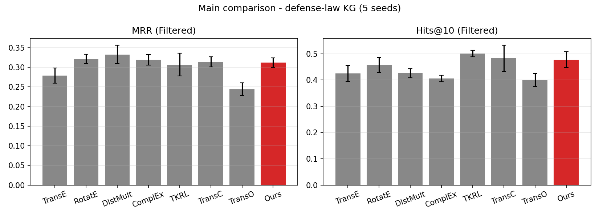

# kge_baseline_benchmark — 국방 법령 KG 위 KGE 베이스라인 7종 비교

> 졸업논문 **Part 2 · 방법론 — 베이스라인 선정 근거**
> 지난 학기 [thesis_transo](https://github.com/Ikuuuu/thesis_transo)에서 TransO 논문을 FB15K로 재현했다면, 이번에는 **직접 구축한 한국어 국방 법령 KG**에서 대표 KGE 모델 7종을 같은 조건으로 학습·평가해 본 연구의 비교 기준을 세웁니다.

## 1. 비교 모델

| 계열 | 모델 | 점수 함수 | 온톨로지 사용 |
|---|---|---|---|
| 거리(Translation) | **TransE** (Bordes 2013) | `‖h + r − t‖₁` | – |
| 회전(Rotation) | **RotatE** (Sun 2019) | `‖h ∘ r − t‖`, r = 단위 복소수 | – |
| 의미 매칭(Bilinear) | **DistMult** (Yang 2015) | `⟨h, r, t⟩` | – |
| 의미 매칭(Complex) | **ComplEx** (Trouillon 2016) | `Re⟨h, r, t̄⟩` | – |
| 타입 투영 | **TKRL** (Xie 2016) | `‖M_type(h)·h + r − M_type(t)·t‖₁` | 엔티티 타입 |
| 클래스 = 구 | **TransC** (Lv 2018) | 인스턴스 ∈ 구(중심, 반지름) + TransE | 클래스 포함 |
| 온톨로지 제약 | **TransO** (Li 2023) | TransE + 타입 응집 제약 | 엔티티 타입 |

7종 모두 `kgekit/models.py`에 NumPy로 직접 구현했습니다(해석적 그래디언트, 벡터화 SGD). GPU나 PyTorch 없이 CPU만으로 돌아가서 폐쇄망 서버에서도 그대로 재현할 수 있습니다.

## 2. 실험 설정

| 항목 | 값 |
|---|---|
| 데이터 | 국방 법령 KG v1.0 — 엔티티 2,352 · 관계 12 · 트리플 7,354 (train 5,877 / valid 730 / test 747) |
| 공통 하이퍼파라미터 | dim 100, 150 epoch, SGD lr 0.05, margin 1.0, 음성 샘플 8, batch 1024, weight decay 1e-5, grad clip 5.0 |
| 평가 | Filtered MRR · Hits@1/3/10, head·tail 양방향 평균 |
| 관계 그룹 분석 | 방향성(인용·외부인용·위임·위임받음·소속·포함), 계층(상위·하위법령) |
| 반복 | seed 42~46 (5회) 평균 |
| 통계 | 트리플 단위 paired bootstrap 1,000회 (TransE 대비) |

## 3. 폴더 구조

```
kge_baseline_benchmark/
├── kgekit/                       # NumPy KGE 엔진
│   ├── models.py                 # TransE, RotatE, DistMult, ComplEx, TKRL, TransC, TransO
│   ├── train.py                  # 학습 루프 (seed·epoch 별 RNG 고정 → 결과 재현)
│   ├── evaluate.py               # Filtered 링크 예측 평가
│   └── stats.py                  # paired bootstrap
├── data/processed/               # KG v1.0 (train/valid/test, entity2id, relation2id)
├── scripts/
│   ├── run_benchmark.py          # 학습·평가 (중단 후 재실행 시 이어서 진행)
│   └── report.py                 # 비교표·관계별 MRR·bootstrap·그림
└── results/
    ├── thesis_final_run2/        # 논문 본 실험 결과 (5 seed)
    └── rerun_seed42/             # 이번 정리에서 다시 돌린 재현성 확인 결과
```

## 4. 실행 방법

```bash
python -m venv .venv && source .venv/bin/activate     # Windows: .venv\Scripts\activate
pip install -r requirements.txt

python scripts/run_benchmark.py                       # 7모델 × 5seed (CPU 약 40~60분)
python scripts/report.py --run results/rerun          # 표·그림

python scripts/run_benchmark.py --epochs 5 --seeds 42 --out results/smoke   # 1~2분 스모크
python scripts/report.py --run results/smoke
```

## 5. 결과 (5 seed 평균, test)



| 모델 | MRR | Hits@1 | Hits@3 | Hits@10 | 방향성 MRR | 계층 MRR |
|---|---|---|---|---|---|---|
| TransE | 0.2787 ± 0.019 | 0.1920 | 0.3282 | 0.4248 | 0.3744 | 0.3264 |
| RotatE | 0.3213 ± 0.012 | 0.2533 | 0.3448 | 0.4572 | 0.3921 | 0.3024 |
| **DistMult** | **0.3329** ± 0.024 | **0.2805** | 0.3578 | 0.4258 | **0.4669** | 0.2282 |
| ComplEx | 0.3190 ± 0.013 | 0.2697 | 0.3369 | 0.4060 | 0.4501 | 0.3940 |
| TKRL | 0.3069 ± 0.029 | 0.2060 | 0.3618 | **0.5007** | 0.3053 | **0.4231** |
| TransC | 0.3142 ± 0.013 | 0.2086 | **0.3823** | 0.4822 | 0.4093 | 0.3279 |
| TransO | 0.2443 ± 0.016 | 0.1479 | 0.2979 | 0.4001 | 0.3210 | 0.3237 |

### 관계별 MRR

| 관계 | test n | TransE | RotatE | DistMult | ComplEx | TKRL | TransC | TransO |
|---|---|---|---|---|---|---|---|---|
| type | 236 | 0.074 | 0.172 | 0.054 | 0.034 | **0.300** | 0.118 | 0.081 |
| 소속 (belongsTo) | 195 | 0.467 | 0.486 | **0.577** | 0.541 | 0.356 | 0.482 | 0.379 |
| 포함 (contains) | 195 | 0.440 | 0.472 | **0.561** | 0.550 | 0.370 | 0.507 | 0.395 |
| 외부인용 | 68 | 0.036 | 0.023 | 0.037 | 0.034 | 0.037 | **0.055** | 0.042 |
| 인용 | 22 | 0.053 | 0.010 | 0.037 | 0.026 | **0.062** | 0.031 | 0.038 |
| 위임 | 4 | 0.274 | 0.376 | 0.355 | **0.665** | 0.530 | 0.221 | 0.227 |
| 상위법령 | 4 | 0.306 | 0.227 | 0.239 | **0.447** | 0.418 | 0.346 | 0.293 |
| 하위법령 | 4 | 0.345 | 0.376 | 0.216 | 0.340 | **0.427** | 0.309 | 0.354 |

### 해석 — 본 연구 방향을 정한 근거

1. **의미 매칭 모델(DistMult·ComplEx)이 소속·포함 같은 1:N 관계에 강해** 전체 MRR이 가장 높습니다. 다만 DistMult는 점수 함수가 대칭이라 `(A, 인용, B)`와 `(B, 인용, A)`를 구분하지 못합니다. 이 KG에서 계층 MRR이 가장 낮은 것(0.228)도 그 때문입니다.
2. **온톨로지를 쓰는 TKRL·TransC는 타입·계층 관계에서 강점**이 분명합니다 (type MRR 0.300, 계층 MRR 0.423).
3. **TransO는 이 데이터에서 TransE보다 낮습니다** (0.244 vs 0.279). 타입 응집 제약이 엔티티 2,352개 중 1,936개가 `Article` 한 클래스에 몰린 소규모 KG에서는 과하게 작동해, 같은 법령 조문들을 구분하기 어렵게 만든 것으로 보입니다.
4. **인용·외부인용은 모든 모델에서 MRR 0.06 이하**로 가장 어려운 관계입니다. 인용 대상이 수백 개 법령에 흩어진 롱테일 구조이기 때문입니다.

→ 그래서 본 연구는 **TransE의 방향성 표현은 유지하면서, 온톨로지에서 나온 방향성·계층·역관계 제약을 손실로 더하는 방식**을 택했습니다 ([ontology_constraint_kge](https://github.com/Ikuuuu/ontology_constraint_kge)).

### 재현성 확인

같은 seed면 결과가 비트 단위로 같도록 epoch별 난수 생성기를 고정했습니다. 이번 정리에서 seed 42를 다시 실행해 논문 기록과 비교했습니다 (`results/rerun_seed42/`).

| 모델 | 논문 기록 (seed 42) | 재실행 (seed 42) | 일치 |
|---|---|---|---|
| TransE | 0.267558 | 0.267558 | ✅ |
| RotatE | 0.302936 | 0.302936 | ✅ |
| DistMult | 0.354325 | 0.354325 | ✅ |
| ComplEx | 0.323546 | 0.323546 | ✅ |
| TKRL | 0.332896 | 0.332896 | ✅ |
| TransC | 0.294385 | 0.294385 | ✅ |
| TransO | 0.272928 | 0.272928 | ✅ |

## 6. 관련 저장소

[defense_law_kg_dataset](https://github.com/Ikuuuu/defense_law_kg_dataset) · [ontology_constraint_kge](https://github.com/Ikuuuu/ontology_constraint_kge) · [thesis_final](https://github.com/Ikuuuu/thesis_final)

---
송재익 · 충북대학교 산업인공지능학과 석사과정 (2025254013)
